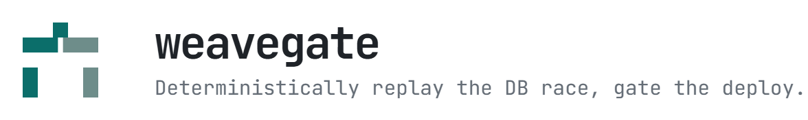
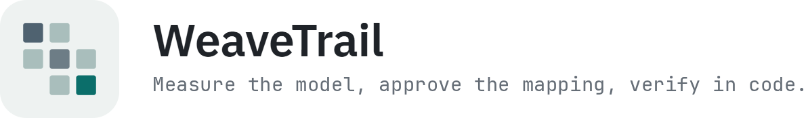

  
  

  <b>Deterministic cores for nondeterministic systems.</b>
   
  <i>Tools that make concurrent, AI-assisted, and parallel systems replayable and measurable.</i>

 

<a href="https://github.com/weavegate/weavegate">
  <picture>
    <source media="(prefers-color-scheme: dark)" srcset="assets/weavegate-dark.png">
    
  </picture>
</a>

**Developer tool that automates database race testing in Spring Boot CI**

- **Replay ·** saves the interleaving between sync-points and reruns it against real MySQL.
- **Judge ·** SQL invariants decide pass or fail, so the verdict does not depend on timing.
- **Prove ·** on one saved schedule, the vulnerable Spring Boot app fails and the fixed one passes, [20/20 each](https://github.com/weavegate/weavegate/blob/main/docs/experiments/spring-replay.md#repeated-paired-test).
- **Gate ·** one workflow step, published on GitHub Marketplace, fails the pull request with the schedule, trace, and violating rows attached.

`Deterministic replay` `Go` `MySQL 8 / InnoDB` `Testcontainers` `GitHub Actions`
  

<a href="https://github.com/WeaveTrail/WeaveTrail">
  <picture>
    <source media="(prefers-color-scheme: dark)" srcset="assets/weavetrail-dark.png">
    
  </picture>
</a>

**Data standardization pipeline that applies AI column mapping only after quality checks and approval**

- **Propose ·** a model maps each column to a common schema, or returns `REVIEW_REQUIRED`.
- **Check ·** a closed contract and dry-run transforms reject invalid proposals; a person approves the exact one by hash.
- **Compute ·** deterministic code computes every result and traces it to its source row.
- **Select ·** six quality criteria, fixed before the run, decide in code whether a model may be applied automatically.

`AI trust boundaries` `Model evaluation` `TypeScript` `Next.js`

 

<b>Performance studies</b> · how much CPU and GPU parallelism speeds up a whole pipeline under a fixed time limit

| Project | What it asks |
|---|---|
| [surveillance-frontier](https://github.com/jaeunda/surveillance-frontier) | Large-scale data processing engine that stress-tests market-surveillance policies within a fixed time budget. Recomputing only the changed range cuts a trial from 1,180.55 ms to 3.36 ms ([349×](https://github.com/jaeunda/surveillance-frontier#latest-result--phase-1), 600K rows, one thread), matching full recomputation in all 2,112 checks (C++ / OpenMP / CUDA) |
| [drone-doa-gpu](https://github.com/jaeunda/drone-doa-gpu) | Real-time acoustic direction finding for drones on an 8-mic array. On a Tesla T4, moving the whole pipeline to the GPU cuts [99.4 ms to 2.58 ms](https://github.com/jaeunda/drone-doa-gpu#phase-1-result) per 64-frame batch (Python / CUDA) |

<b>Team projects</b> · built with teams across embedded, backend, and AI

 

| Project | What it does |
|---|---|
| [Ongi Device](https://github.com/Ongi-Team/ongi-device) | Connected medication-dispenser firmware, from caregiver schedule to confirmed intake. The device runs the server's schedule on synced time, opens the right slot, and reports whether the pill was actually taken (C / ESP-IDF) |
| [Team-po / Server](https://github.com/Team-po/Server) | Team matching and collaboration for developer side projects. Matching runs in a locked transaction so no one lands on two teams, and each team gets a group chat, GitHub integration, and an AI-generated development guide (Java / Spring Boot) |
| [CarryCheck](https://github.com/jaeunda/CarryCheck) | Hybrid RAG agent for airline baggage rules, with deterministic decisions and guardrailed generation. On a 10-question set, BM25 and Qwen3 embeddings fused by RRF reach [Recall@3 1.00](https://github.com/jaeunda/CarryCheck#performance), a harness that rejects changed statuses or unknown source IDs passes 10/10, and selective context cuts one request's tokens by 38.6% (Python / FuriosaAI) |

<b>Foundations</b> · coursework and labs in kernels, file systems, storage, compilers, and cloud platforms

 

| Project | What it involved |
|---|---|
| [xv6-kernel-extensions](https://github.com/jaeunda/xv6-kernel-extensions) | Kernel changes for saved file versions, observable physical memory, and weighted scheduling in xv6. Copy-on-write snapshots allocate 98.85% fewer extra blocks than a full copy (3 vs 262), and stride scheduling holds 1:2:4 CPU shares within 0.14 points, against 23.81 for round-robin (C) |
| [linux-filesystem-tools](https://github.com/jaeunda/linux-filesystem-tools) | File organization tools from interactive copy to a background daemon, plus a read-only ext2 image inspector. Organizing 512 files / 128 MiB takes a median 0.122 s, with all 2,560 copies matching by SHA-256 (C) |
| [storage-io-lab](https://github.com/jaeunda/storage-io-lab) | Flash I/O, a hybrid flash translation layer, and fixed-slot record storage on a file-backed emulator. Reusing 250 deleted slots keeps a 1,000-record file at zero growth, and write amplification measures 1.000× to 3.988× by workload (C) |
| [compiler](https://github.com/jaeunda/compiler) | Eight steps from an expression calculator to a C-subset compiler. RD and LR parsing, scoped symbol tables, and type annotation lead to stack-machine assembly that the included interpreter runs (C) |
| [cloud-native-labs](https://github.com/jaeunda/cloud-native-labs) | Concept notes and hands-on labs on how VMs, networking, and shared storage hold up a container platform. Covers Kubernetes workloads, Services and Ingress, persistent volumes, scheduling and rollouts, CI/CD, and AWS EKS (Kubernetes / AWS) |

